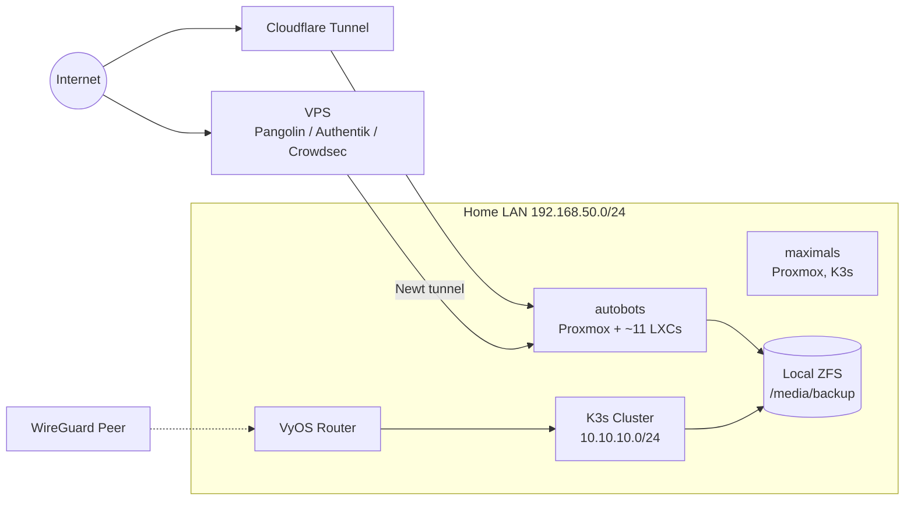
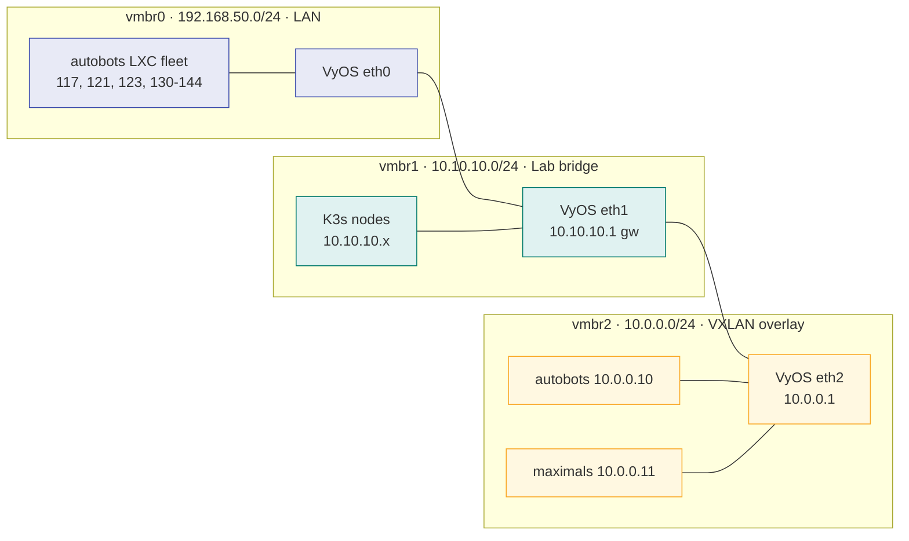
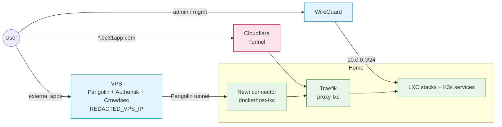
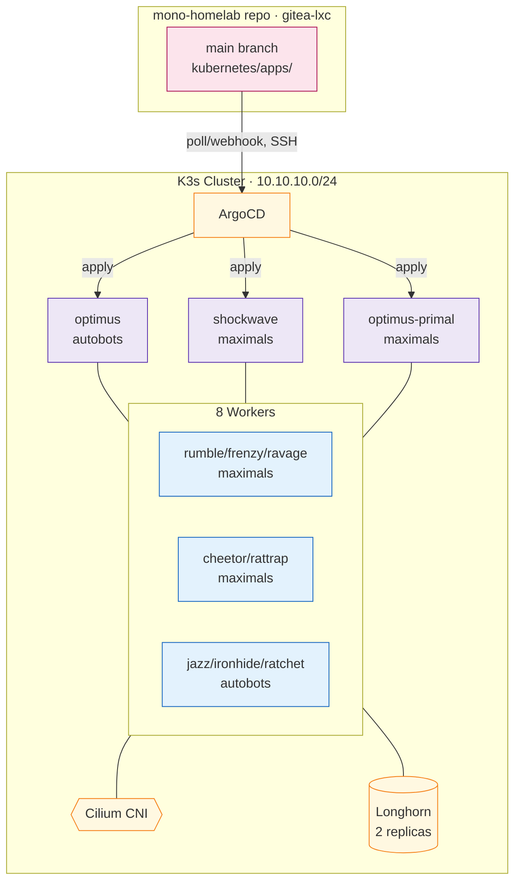
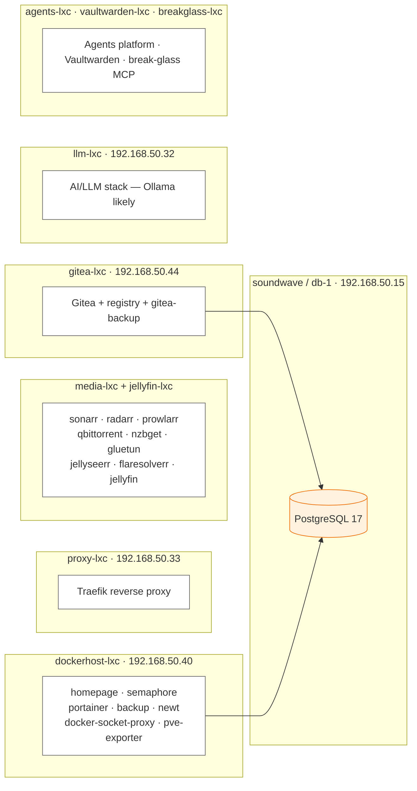
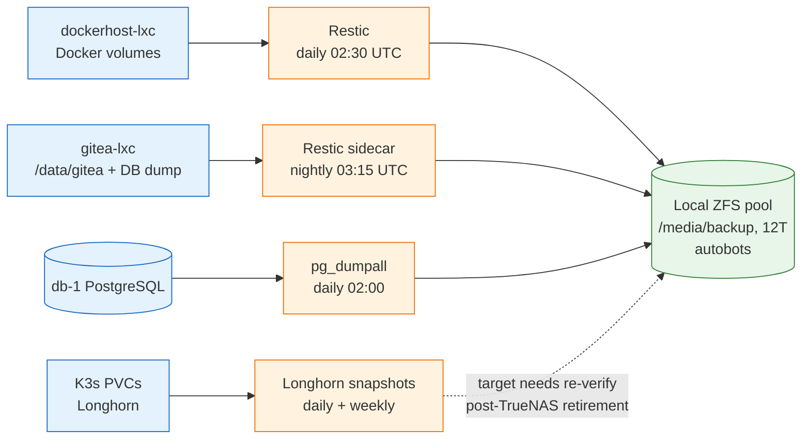

# Homelab Architecture

End-to-end map of the homelab as of **2026-07-11**, live-verified via SSH (`pct list`/`qm list`/`docker ps`) and `kubectl`. Every section has a Mermaid diagram (renders inline on GitHub/Gitea) followed by an ASCII fallback.

> **Two-repo note:** this repo (`mono-homelab`, canonical, on gitea-lxc) supersedes the older `homelab` repo (`github.com/pattersonbl2/homelab`), which is mid-migration and still holds design docs for the cutover. The infra described below reflects live reality, matching this repo's own commit history (`feat(infra): rework docker host...`, `feat(media): jellyfin+llm+proxy LXC stacks...retire k8s arr-stack`, etc.) — but this file itself, along with `CLAUDE.md`, had drifted out of date relative to those commits until this pass.

## Contents

- [At a glance](#at-a-glance)
- [Physical layout (Proxmox cluster)](#physical-layout-proxmox-cluster)
- [Network topology](#network-topology)
- [Ingress and external access](#ingress-and-external-access)
- [K3s cluster + GitOps](#k3s-cluster--gitops)
- [Service / stack map](#service--stack-map)
- [Data + backup flows](#data--backup-flows)
- [Address book](#address-book)

---

## At a glance

| Plane | Where it lives | What it runs |
|---|---|---|
| Compute | 2x Proxmox (autobots, maximals) | VMs + LXCs |
| Docker | ~11 LXCs on autobots | Compose stacks (Traefik, *arr, AI, Gitea, etc.) |
| Kubernetes | 3 CP + 8 workers | ArgoCD-managed apps (partial — media stack migrated out) |
| Data | db-1 LXC | PostgreSQL 17 (no Redis) |
| Edge | VPS (REDACTED_VPS_IP) | Pangolin, Authentik, Crowdsec |
| Network | VyOS VM, vmbr0/1/2 | LAN, lab bridge, VXLAN mgmt overlay |
| Backup | Local ZFS pool on autobots | 12T `/media/backup` (TrueNAS retired) |



```text
                Internet
                   │
        ┌──────────┼──────────────┐
        │          │              │
   Cloudflare    VPS         WireGuard
    Tunnel  (Pangolin/        (remote)
        │   Authentik)            │
        ▼          │              ▼
    autobots ◄─────┘         VyOS Router
   (~11 LXCs)                     │
        │                         ▼
        └──► local ZFS      K3s Cluster
             /media/backup   (10.10.10.0/24)
```

**Note on TrueNAS:** the TrueNAS VM (formerly 192.168.50.106) no longer exists. All backups now land on a local 12T ZFS pool directly on autobots.

---

## Physical layout (Proxmox cluster)

Two Proxmox nodes: **autobots** hosts nearly everything (Docker LXC fleet + some K3s), **maximals** hosts most of K3s.

```mermaid
flowchart TB
  classDef vm fill:#e3f2fd,stroke:#1976d2,color:#0d47a1
  classDef lxc fill:#fff3e0,stroke:#ef6c00,color:#e65100
  classDef router fill:#f3e5f5,stroke:#7b1fa2,color:#4a148c

  subgraph AB[autobots  ·  192.168.50.176]
    direction TB
    DB1[soundwave / db-1<br/>LXC 117<br/>PostgreSQL 17]:::lxc
    PIH[pihole-lxc<br/>LXC 121]:::lxc
    HRM[hermes-lxc / wheeljack<br/>LXC 123]:::lxc
    MED[media-lxc<br/>LXC 130]:::lxc
    JEL[jellyfin-lxc<br/>LXC 131]:::lxc
    LLM[llm-lxc<br/>LXC 132]:::lxc
    PRX[proxy-lxc / Traefik<br/>LXC 133]:::lxc
    DKH[dockerhost-lxc<br/>LXC 140]:::lxc
    AGT[agents-lxc<br/>LXC 141]:::lxc
    VW[vaultwarden-lxc<br/>LXC 142]:::lxc
    GIT[gitea-lxc<br/>LXC 143]:::lxc
    BG[breakglass-lxc<br/>LXC 144]:::lxc
    VY[vyos-gw<br/>VM 200]:::router
    KCP1[optimus / k3s-cp-1<br/>VM 300]:::vm
    KW3[jazz / worker-3<br/>VM 312]:::vm
    KW4[ironhide / worker-4<br/>VM 313]:::vm
    KW5[ratchet / worker-5<br/>VM 314]:::vm
  end

  subgraph MX[maximals  ·  192.168.50.99]
    direction TB
    KCP2[shockwave / k3s-cp-2<br/>VM 301]:::vm
    KCP3[optimus-primal / k3s-cp-3<br/>VM 302]:::vm
    KW1[rumble / worker<br/>VM 310]:::vm
    KW2[frenzy / worker<br/>VM 311]:::vm
    KW6[ravage / worker<br/>VM 315]:::vm
    KW7[cheetor / worker-7<br/>VM 316]:::vm
    KW8[rattrap / worker-8<br/>VM 317]:::vm
  end
```



```text
┌───────────────────────────────────────────────┐  ┌───────────────────────────────────┐
│  autobots   192.168.50.176                    │  │  maximals  192.168.50.99          │
├───────────────────────────────────────────────┤  ├───────────────────────────────────┤
│  LXC 117  soundwave/db-1   (PG17)              │  │  VM 301  shockwave (k3s-cp-2)      │
│  LXC 121  pihole-lxc                           │  │  VM 302  optimus-primal (k3s-cp-3) │
│  LXC 123  hermes-lxc / wheeljack               │  │  VM 310  rumble (worker)           │
│  LXC 130  media-lxc  (*arr stack)              │  │  VM 311  frenzy (worker)           │
│  LXC 131  jellyfin-lxc                         │  │  VM 315  ravage (worker)           │
│  LXC 132  llm-lxc  (AI/Ollama)                 │  │  VM 316  cheetor (worker-7)        │
│  LXC 133  proxy-lxc  (Traefik)                 │  │  VM 317  rattrap (worker-8)        │
│  LXC 140  dockerhost-lxc  (homepage, etc.)     │  └───────────────────────────────────┘
│  LXC 141  agents-lxc                           │
│  LXC 142  vaultwarden-lxc                      │
│  LXC 143  gitea-lxc                            │
│  LXC 144  breakglass-lxc                       │
│  VM  200  vyos-gw                              │
│  VM  300  optimus (k3s-cp-1)                   │
│  VM 312-314  jazz/ironhide/ratchet (workers)   │
│  VM 400-402  CKA exam-prep cluster (stopped)   │
└───────────────────────────────────────────────┘
```

**Retired since this doc was last accurate:** decepticons (2nd Proxmox node, hardware powered off May 2026), homelab-1 VM, localai-gpu/perceptor VM 115, TrueNAS VM 555, blaster/tailscale LXC 116, homeassistant VM 118, old jellyfin LXC 119, pihole-lxc-2 (122).

**PCI passthrough:** `rtx3060-openclaw` mapping still points `node=autobots`, but its original VM target (perceptor/openclaw-1) is gone — verify it now targets llm-lxc (132) before relying on GPU passthrough.

---

## Network topology

Unchanged bridge layout: three Linux bridges divide LAN, lab, and a VXLAN management overlay.



**Why the VXLAN?** Port 8006 (Proxmox UI) is firewalled off vmbr0 — the UI is only reachable over the management overlay. SSH on the LAN IPs remains as a break-glass path.

---

## Ingress and external access



**Cloudflare Tunnel ingress is Terraform-managed** (`infrastructure/terraform-cloudflare/`), NOT the K3s gitops configmap — the tunnel pulls a *remote* config that overrides any local `--config` file. To change public routing, edit `.tf` and `terraform apply` there. As of the last known state, no public rule routes `gitea.bp31app.com` — Gitea only works externally if you add one; on-LAN it works via split-horizon DNS to gitea-lxc directly.

WireGuard config lives at `/opt/homebrew/etc/wireguard/homelab.conf` on the user's macOS workstation.

---

## K3s cluster + GitOps

3 control planes, 8 workers, all on the lab bridge. **The K3s→LXC migration is deliberate and partial**: media, Gitea, Vaultwarden, Jellyfin, and the LLM stack moved to dedicated LXCs on autobots; uptime-kuma, ntfy, wikijs, n8n, cloudflare-tunnel, monitoring, Longhorn, Falco, Trivy, and Renovate remain on K3s. The old K3s `media` namespace still exists but its pods have been broken (`ContainerCreating`) for an extended period — it's dead weight, not a working deployment.



**Operating notes:**

- ArgoCD's primary repo (since 2026-07-08) is `ssh://git@192.168.50.44:2222/bp31/mono-homelab.git` on gitea-lxc, **not** `github.com/pattersonbl2/gitops` (legacy/read-only now).
- ArgoCD owns every K8s resource it tracks. Never `kubectl apply` against gitops-managed namespaces — selfHeal will revert it.
- Kubeconfig: `~/.kube/homelab-k3s.yaml`.
- Grafana dashboards are managed by the terraform-grafana repo, **not** by Helm `gnetId` imports.

---

## Service / stack map

Docker stacks are now split between the autobots LXC fleet (mostly Docker Compose) and the K3s cluster (ArgoCD-managed), plus a residual VPS tier.



```text
dockerhost-lxc (140)      proxy-lxc (133)      media-lxc (130) + jellyfin-lxc (131)
 ├─ homepage                └─ Traefik           ├─ sonarr / radarr / prowlarr
 ├─ semaphore                                    ├─ qbittorrent / nzbget (via gluetun)
 ├─ portainer                                    ├─ jellyseerr / flaresolverr / recyclarr
 ├─ backup (Restic)                              └─ jellyfin
 ├─ newt (Pangolin)
 ├─ docker-socket-proxy         gitea-lxc (143)          llm-lxc (132)
 └─ pve-exporter                 └─ Gitea + registry       └─ AI/LLM (Ollama, unverified detail)
                                    + gitea-backup

agents-lxc (141)   vaultwarden-lxc (142)   breakglass-lxc (144, new 2026-07-11)
 └─ agents platform  └─ Vaultwarden          └─ break-glass MCP endpoint (systemd)

K3s (ArgoCD-managed, partial): uptime-kuma, ntfy, wikijs, n8n, cloudflare-tunnel,
monitoring (kube-prometheus-stack + Loki), longhorn, falco, trivy-operator, renovate
```

`DB_HOST` remains the only DB knob for Docker stacks that use it; no per-stack DB containers exist by design.

---

## Data + backup flows

Backups now land on a **local ZFS pool on autobots**, not TrueNAS (retired).



```text
  dockerhost-lxc volumes ─► Restic (daily 02:30) ────────┐
  gitea-lxc /data + DB dump ─► Restic sidecar (03:15) ────┼─► /media/backup (12T ZFS, autobots)
  db-1 PostgreSQL ─► pg_dumpall (daily 02:00, 30d) ───────┤     datasets: db/ docker/ k3s/ gitea-lxc/
  K3s PVCs ─► Longhorn (daily/weekly) ────────────────────┘     (target needs re-verification)
```

**Secrets** are encrypted with SOPS (GPG key) at `stacks/env.enc`. Decrypt to `stacks/env` before deploys; re-encrypt in place after edits.

```bash
sops -d --input-type dotenv --output-type dotenv stacks/env.enc > stacks/env
cp stacks/env stacks/env.enc
sops -e --input-type dotenv --output-type dotenv --in-place stacks/env.enc
```

**Manual ops cheatsheet:**

```bash
# Restic (dockerhost-lxc)
ssh -F /dev/null -o IdentitiesOnly=yes -i ~/.ssh/id_ed25519_homelab root@192.168.50.176 "pct exec 140 -- docker exec backup /bin/bash /scripts/backup.sh"

# Postgres (db-1) — root SSH is denied, go through autobots
ssh -F /dev/null -o IdentitiesOnly=yes -i ~/.ssh/id_ed25519_homelab root@192.168.50.176 "pct exec 117 -- /usr/local/bin/backup-databases.sh"
```

---

## Address book

| Host | IP | Role |
|---|---|---|
| autobots | 192.168.50.176 (mgmt 10.0.0.10) | Proxmox node 1 |
| maximals | 192.168.50.99 (mgmt 10.0.0.11) | Proxmox node 2 |
| soundwave / db-1 | 192.168.50.15 (LXC 117) | PostgreSQL 17 |
| pihole-lxc | 192.168.50.20 (LXC 121) | Primary DNS (no replica currently) |
| hermes-lxc / wheeljack | 192.168.50.25 (LXC 123) | Hermes AI agent (Docker) |
| media-lxc | 192.168.50.30 (LXC 130) | *arr stack |
| jellyfin-lxc | 192.168.50.31 (LXC 131) | Jellyfin |
| llm-lxc | 192.168.50.32 (LXC 132) | AI/LLM |
| proxy-lxc | 192.168.50.33 (LXC 133) | Traefik |
| dockerhost-lxc | 192.168.50.40 (LXC 140) | homepage, semaphore, backup, newt |
| agents-lxc | 192.168.50.41 (LXC 141) | Agents platform |
| vaultwarden-lxc | 192.168.50.42 (LXC 142) | Vaultwarden |
| gitea-lxc | 192.168.50.44 (LXC 143) | Gitea + registry |
| breakglass-lxc | 192.168.50.46 (LXC 144) | Break-glass MCP endpoint |
| vyos-gw | 192.168.50.18 / 10.10.10.1 / 10.0.0.1 | Router |
| VPS | REDACTED_VPS_IP | Pangolin + Authentik + Crowdsec |

**Retired — do not use:** homelab-1 (192.168.50.137), localai-gpu/perceptor (192.168.50.68), TrueNAS (192.168.50.106), decepticons (192.168.50.26).

**SSH (use the homelab key explicitly to avoid PIV conflicts):**

```bash
ssh -F /dev/null -o IdentitiesOnly=yes -i ~/.ssh/id_ed25519_homelab <user>@<host>
# root@192.168.50.176   · autobots — then `pct exec <VMID> -- <cmd>` for any LXC above
# root@192.168.50.99    · maximals
# db-1 (117) root SSH is DENIED — go through autobots + pct exec
```
